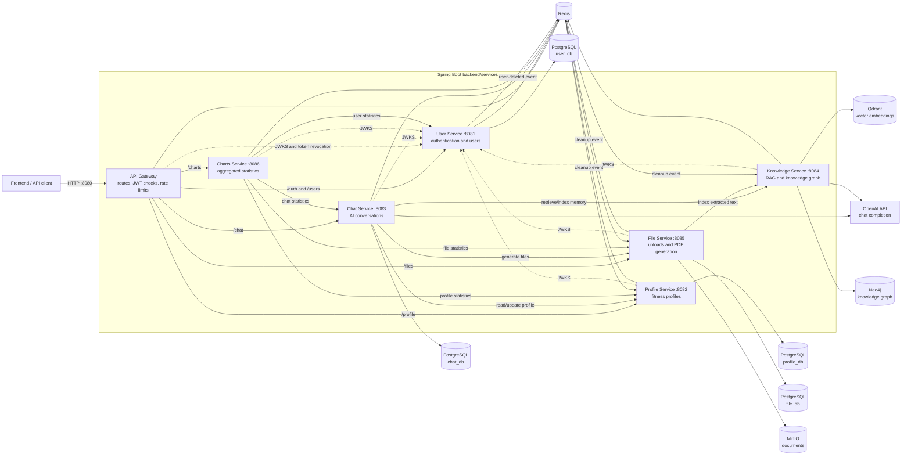
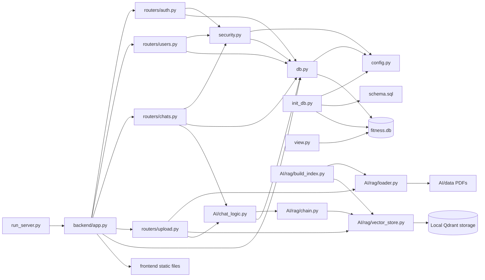

# Backend architecture and file relationships

The repository contains two parallel backend implementations:

- The Spring Boot microservices under `backend/services`, deployed through `infra/docker-compose.yml`.
- A legacy FastAPI/SQLite monolith under `backend`, with AI/RAG modules under `AI`.

Generated `target/`, cache files, compiled classes, and tests are omitted because they are not production runtime dependencies.

## Service architecture

Solid arrows are request or storage flows. Dotted arrows represent authentication-related dependencies.

## Production file relationships

```mermaid
flowchart TB
    subgraph Gateway[api-gateway]
        GA[ApiGatewayApplication.java]
        GR[application.yml<br/>route definitions]
        GSC[GatewaySecurityConfig.java]
        GJWT[RevocationCheckingJwtDecoder.java]
        GL[RateLimitConfig.java]
        GP[pom.xml + Dockerfile]
        GA --> GSC
        GA --> GL
        GSC --> GJWT
        GR --> GSC
        GR --> GL
        GP --> GA
    end

    subgraph User[user-service]
        UA[UserServiceApplication.java]
        UC[AuthController.java]
        UAC[AdminUserController.java]
        US[UserService.java]
        UR[UserRepository.java]
        UM[User.java<br/>Role.java]
        UD[AuthDtos.java<br/>ApiResponse.java]
        UJWT[JwtTokenService.java<br/>RsaKeyProvider.java<br/>JwksController.java]
        UREV[TokenRevocationStore.java]
        UE[UserEventPublisher.java]
        UEX[ApiException.java<br/>GlobalExceptionHandler.java]
        UCFG[SecurityConfig.java<br/>application.yml]
        UP[pom.xml + Dockerfile]
        UA --> UC
        UA --> UAC
        UC --> US
        UAC --> US
        UC --> UD
        UAC --> UD
        US --> UR
        US --> UJWT
        US --> UREV
        US --> UE
        US --> UEX
        UR --> UM
        UD --> UM
        UJWT --> UM
        UCFG --> UJWT
        UP --> UA
    end

    subgraph Profile[profile-service]
        PA[ProfileServiceApplication.java]
        PC[ProfileController.java]
        PS[ProfileService.java]
        PR[ProfileRepository.java]
        PM[Profile.java]
        PD[ProfileDtos.java<br/>ApiResponse.java]
        PE[UserDeletedListener.java]
        PEX[GlobalExceptionHandler.java]
        PSEC[SecurityConfig.java]
        PCFG[application.yml]
        PP[pom.xml + Dockerfile]
        PA --> PC
        PC --> PS
        PC --> PD
        PS --> PR
        PS --> PD
        PR --> PM
        PD --> PM
        PE --> PS
        PEX --> PD
        PP --> PA
    end

    subgraph Chat[chat-service]
        CA[ChatServiceApplication.java]
        CC[ChatController.java]
        CAC[AdminChatController.java]
        CS[ChatService.java]
        CST[ChatStatsService.java]
        STORE[ConversationStore.java]
        STM[ShortTermMemory.java]
        LTM[LongTermMemoryExtractor.java]
        MODEL[AssistantModel.java<br/>SystemPrompt.java]
        TOOLS[ChatTools.java]
        CLIENT[DownstreamClients.java]
        REPO[ConversationRepository.java<br/>ChatMessageRepository.java]
        ENT[Conversation.java<br/>ChatMessage.java]
        DTO[ChatDtos.java<br/>ApiResponse.java]
        CCFG[AppConfig.java<br/>SecurityConfig.java<br/>application.yml]
        CEX[GlobalExceptionHandler.java]
        CP[pom.xml + Dockerfile]
        CA --> CC
        CA --> CAC
        CC --> CS
        CC --> CST
        CC --> STORE
        CC --> STM
        CAC --> CST
        CAC --> STORE
        CS --> MODEL
        CS --> TOOLS
        CS --> CLIENT
        CS --> STM
        CS --> LTM
        CS --> STORE
        LTM --> CLIENT
        STM --> REPO
        STORE --> REPO
        CST --> REPO
        REPO --> ENT
        DTO --> ENT
        TOOLS --> CLIENT
        CCFG --> STM
        CCFG --> STORE
        CEX --> DTO
        CP --> CA
    end

    subgraph Files[file-service]
        FA[FileServiceApplication.java]
        FC[FileController.java]
        FS[FileService.java]
        FK[KnowledgeClient.java]
        FPFD[PdfRenderer.java<br/>PdfTextExtractor.java<br/>TextChunker.java]
        FST[ObjectStorage.java<br/>MinioObjectStorage.java<br/>StorageException.java]
        FR[FileRecordRepository.java]
        FM[FileRecord.java]
        FD[FileDtos.java<br/>ApiResponse.java]
        FDEL[UserDeletedListener.java]
        FSEC[Caller.java<br/>SecurityConfig.java]
        FEX[GlobalExceptionHandler.java]
        FCFG[application.yml]
        FP[pom.xml + Dockerfile]
        FA --> FC
        FC --> FS
        FC --> FD
        FC --> FSEC
        FS --> FK
        FS --> FPFD
        FS --> FST
        FS --> FR
        FS --> FSEC
        FR --> FM
        FD --> FM
        FDEL --> FS
        FEX --> FD
        FP --> FA
    end

    subgraph Knowledge[knowledge-service]
        KA[KnowledgeServiceApplication.java]
        KC[KnowledgeController.java]
        KS[KnowledgeService.java]
        KV[VectorIndexService.java]
        KGS[GraphService.java]
        KGE[GraphExtractor.java]
        KGR[GraphRepository.java]
        KGDATA[GraphKeys.java<br/>Triple.java]
        KD[KnowledgeDtos.java<br/>ApiResponse.java]
        KDEL[UserDeletedListener.java]
        KSEC[Caller.java<br/>SecurityConfig.java]
        KCFG[AppConfig.java<br/>application.yml]
        KEX[GlobalExceptionHandler.java]
        KP[pom.xml + Dockerfile]
        KA --> KC
        KC --> KS
        KC --> KD
        KC --> KSEC
        KS --> KV
        KS --> KGS
        KS --> KSEC
        KGS --> KGE
        KGS --> KGR
        KGE --> KGDATA
        KGR --> KGDATA
        KDEL --> KV
        KDEL --> KGR
        KEX --> KD
        KP --> KA
    end

    subgraph Charts[charts-service]
        CHA[ChartsServiceApplication.java]
        CHC[ChartsController.java]
        CHS[ChartsService.java]
        CHCL[ServiceClient.java]
        CHCACHE[ChartCache.java]
        CHD[ApiResponse.java]
        CHSEC[SecurityConfig.java]
        CHCFG[application.yml]
        CHP[pom.xml + Dockerfile]
        CHA --> CHC
        CHC --> CHS
        CHC --> CHD
        CHS --> CHCL
        CHS --> CHCACHE
        CHP --> CHA
    end

    GR -. routes .-> UC
    GR -. routes .-> PC
    GR -. routes .-> CC
    GR -. routes .-> FC
    GR -. routes .-> CHC
    CLIENT --> KC
    CLIENT --> PC
    CLIENT --> FC
    FK --> KC
    CHCL --> UC
    CHCL --> PC
    CHCL --> CAC
    CHCL --> FC
    GJWT -. JWKS .-> UJWT
    PSEC -. JWKS .-> UJWT
    CCFG -. JWKS .-> UJWT
    FSEC -. JWKS .-> UJWT
    KSEC -. JWKS .-> UJWT
    CHSEC -. JWKS .-> UJWT
```

## Legacy FastAPI backend

